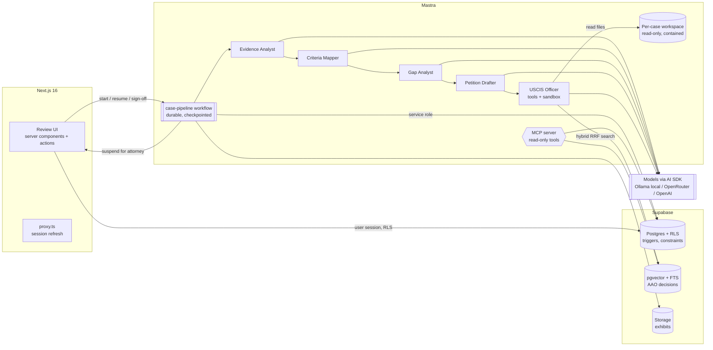

# PetitionPilot

**O-1A evidence mapping with source-cited drafting and attorney review.**

PetitionPilot takes an applicant's documents (CV, press, papers, award letters), maps every piece of evidence to the eight O-1A criteria of 8 CFR 214.2(o)(3)(iii), finds the gaps, drafts the petition with a citation on every sentence, has an adversarial "USCIS officer" agent attack the draft using real Administrative Appeals Office decisions, and stops for an attorney to review and sign off.

> **Not legal advice.** This is a demonstration project. All applicant data is fictional. Every draft must be reviewed and signed by a licensed attorney.

Stack: **Next.js 16 · React 19 · TypeScript · Supabase (Postgres 17, RLS, Storage, pgvector) · Vercel AI SDK 7 · Mastra 1.x · MCP (2026-07-28)**. Runs entirely on local models through Ollama by default ($0, documents never leave the machine); hosted models are a one-line config change.

---

## What it does

| Step | What happens | Where it shows up |
|---|---|---|
| 1. Intake | Upload PDFs per case into private, per-case storage. Each file is hashed (SHA-256) and labeled as an exhibit (A, B, C…). | Exhibits tab |
| 2. Evidence mapping | The **Evidence Analyst** extracts claims with a verbatim quote and page number. Every quote is verified against the page text in code; unverifiable claims are discarded. The **Criteria Mapper** rates all 8 criteria (strong / moderate / weak / none) and cites the claims it relied on. | Evidence map |
| 3. Gap detection | The **Gap Analyst** checks the 3-of-8 threshold, the final-merits step, and the non-criteria requirements (advisory opinion, contract/itinerary, U.S. employer), then writes plain-English follow-up questions for the client. | Evidence map, Client questions |
| 4. Drafting | The **Petition Drafter** writes each criterion section. It may cite only IDs of verified claims; code attaches the quotes. Sentences without a valid source are deleted, and a database constraint rejects any uncited sentence. | Draft review |
| 5. Attorney review | Source on the left (cited passage highlighted), draft on the right. Accept, edit, or reject each paragraph. Full version history. The sign-off is enforced by the database: attorney role only, every paragraph resolved, draft hashed and locked. | Draft review |
| 6. Objection check | The **USCIS Officer** agent reads the case from a read-only sandbox and searches published AAO O-1 decisions to predict RFE and denial grounds, with suggested cures and verified AAO quotes. | Officer objections |

## Architecture



### Design choices

- **Workflow first, agent where it earns its place.** The known sequence is a Mastra workflow (predictable, testable, cheap). Only the officer, whose path isn't known in advance, is a tool-using agent.
- **Recovery from failure.** Mastra persists workflow snapshots in Postgres, so the attorney-review suspension survives restarts. On top of that, each step commits a checkpoint row last and clears its own partial writes first: a retried or restarted run reuses finished work instead of calling the models again. `PILOT_CHAOS=<step>` injects failures; `npm run pipeline -- crash-demo alvarez` kills the worker with SIGKILL and resumes it in a new process.
- **Sandboxed agent.** The officer's file tools resolve per request to `.workspaces/<case>/<run>/` with path containment and read-only mode; write/edit/delete tools are disabled.
- **"No source, no sentence," three times over.** Closed set of citable claim IDs, deterministic quote verification (exact, normalized, bounded fuzzy match), and a Postgres CHECK constraint.
- **Permissions live in the database.** Row-level security on every table; the client role sees only their own case, status and questions. Version history is written by triggers into an append-only table. Sign-off is an RLS policy plus a trigger that hashes and locks the draft.
- **Observability.** Every step, model call, retry and checkpoint is an `agent_events` row with tokens, cost and latency, shown in the Agent run tab.
- **Grounding in real public data.** 76 USCIS AAO non-precedent O-1 decisions (2023 to Sep 2026) are chunked into pgvector (HNSW) plus Postgres full-text search, fused with Reciprocal Rank Fusion.
- **MCP.** `npm run mcp` serves read-only tools (`list_cases`, `get_evidence_map`, `read_exhibit_page`, `verify_citation`, `search_aao_decisions`) to Claude Code, Claude Desktop, or any MCP client.

## Evaluation

Full method, numbers and limitations: **[EVALS.md](EVALS.md)**. All numbers below come from local models (`qwen3:8b` as worker, drafter and officer; `gemma4` as judge, a different model family) on a 16 GB Apple M5, at **$0**.

| Eval | Result | How it is measured |
|---|---|---|
| **Objection recall on 31 real AAO O-1A dismissals** (100 dispositive grounds) | **55%** strict (95% CI 45–64%), 60% lenient; 53% on the 2026 hold-out | The officer sees only a neutral summary of the record (outcome words filtered, 7 leaky cases also reported separately: 54%), AAO retrieval excludes the decision under test, and an independent judge maps each real ground to a prediction targeting the same criterion. |
| **Citation integrity** | **100%** of cited quotes found verbatim on the cited page; **0** uncited sentences | Deterministic: code verification plus a database CHECK constraint. |
| **Citation faithfulness** (68 drafted sentences) | **53%** fully supported (95% CI 41–64%), 12% partial | Mastra scorer with an LLM judge at temperature 0. Most failures are evaluative words the 8B drafter adds ("indicating high selectivity"). Human calibration sample is in `evals/human/`. |
| **Reliability** (3 runs per case) | "≥ 3 criteria" verdict identical in **100%** of cases; 97.9% met/not-met agreement; Fleiss' κ 0.69 | Re-running evidence mapping from scratch; claim-set overlap (Jaccard 0.46) shows the model picks different quotes but reaches the same conclusions. |
| **Durability** | 2 injected failures → reached the attorney checkpoint, every step committed exactly once; `kill -9` mid-run → a fresh process resumes from checkpoints | `PILOT_CHAOS` fault injection and `npm run pipeline -- crash-demo`. |
| **Cost / speed** | $0 per case; evidence mapping 8–20 min per case on the M5 | Event log (`agent_events`). |

Both LLM judges were revised once after inspecting their output (EVALS.md, "Judge revisions"); the earlier, harsher and laxer results are kept alongside.

## Quickstart

Requirements: Node 22+, Docker, [Ollama](https://ollama.com).

```bash
npm install
npm run db:start                     # local Supabase (Postgres, Auth, Storage)
cp .env.example .env.local           # fill values from `npx supabase status -o env`

ollama pull qwen3:8b && ollama pull gemma4 && ollama pull nomic-embed-text
# Server settings used for the reported results (16 GB machine):
#   OLLAMA_CONTEXT_LENGTH=16384 OLLAMA_FLASH_ATTENTION=1 OLLAMA_KV_CACHE_TYPE=q8_0 \
#   OLLAMA_KEEP_ALIVE=30m OLLAMA_MAX_LOADED_MODELS=2 ollama serve

npm run fixtures && npm run seed     # fictional applicants + demo users
npm run aao:ingest                   # public AAO decisions -> pgvector
npm run pipeline -- run alvarez      # or click "Run agents" in the app
npm run dev                          # http://localhost:3000
```

Demo logins (password `petition-pilot-demo`):

| Role | Email | Can do |
|---|---|---|
| Attorney | `attorney@petition-pilot.test` | Everything, including the only sign-off |
| Paralegal | `paralegal@petition-pilot.test` | Run agents, edit drafts; cannot sign off |
| Client | `priya.raman@client.petition-pilot.test` (also `mateo.alvarez@…`, `lena.okafor@…`) | Own case status and questions only |

Pipeline CLI: `npm run pipeline -- run|resume|redo-from|crash-demo <persona|runId>` (personas: `raman` strong, `alvarez` borderline, `okafor` weak).

Evals:

```bash
npx tsx --env-file=.env.local evals/golden/build.ts   # build golden cases from AAO decisions
npm run eval:golden
npm run eval:faithfulness
npm run eval:reliability
npm run eval:report                                   # writes EVALS.md + the in-app Evals page
```

Tests: `npm test` (citation verifier, budget guard, statistics, and RLS/permission tests against the local database). `npm run typecheck`, `npm run lint`.

### Choosing models

`PILOT_PROVIDER=ollama` (default), `openrouter` or `openai`. Per-role overrides: `PILOT_WORKER_MODEL`, `PILOT_DRAFTER_MODEL`, `PILOT_OFFICER_MODEL`, `PILOT_JUDGE_MODEL`. With hosted models a hard spend cap applies (`PILOT_BUDGET_USD`, stops at 90%).

## Project layout

```
src/
  app/                    Next.js routes (cases, review, objections, questions, exhibits, run, evals)
  components/             UI, review workspace, source panel
  lib/o1a/                criteria, requirements, reason codes, output schemas
  lib/citations/          deterministic quote verification + highlighting
  lib/aao/                hybrid retrieval over AAO decisions
  lib/ai/                 model routing, pricing, budget guard, embeddings
  mastra/                 agents, tools, workspace sandbox, workflow, MCP server
supabase/migrations/      schema, RLS, triggers, retrieval function
scripts/                  fixtures, seed, AAO ingest, pipeline CLI, MCP stdio server
evals/                    golden set builder, eval runners, judges, statistics, reports
tests/                    RLS / permission tests
data/aao/decisions.json   manifest of the public decisions used
fixtures/                 generated fictional applicant PDFs
```

## Data

- **Applicants are fictional.** People, organizations and publications in `scripts/fixtures/personas.ts` are invented; every generated PDF is stamped "FICTIONAL SAMPLE DOCUMENT."
- **AAO decisions are public** U.S. government records, redacted by USCIS before publication, from the [AAO non-precedent decisions library](https://www.uscis.gov/administrative-appeals/aao-decisions/aao-non-precedent-decisions).

## Known limitations

- Results come from an 8B local model; a larger model would mostly improve drafting faithfulness (the drafter adds evaluative words the sources do not state). The citation layer already blocks unsourced or unverifiable text.
- Golden labels come from published AAO dismissals, which only cover cases that were appealed; recall is measured on grounds the AAO actually wrote down.
- The faithfulness judge is not yet calibrated against human labels; a 40-sentence labeling sample is ready in `evals/human/faithfulness-sample.csv`.
- Full details: [EVALS.md](EVALS.md), "Known limitations".
